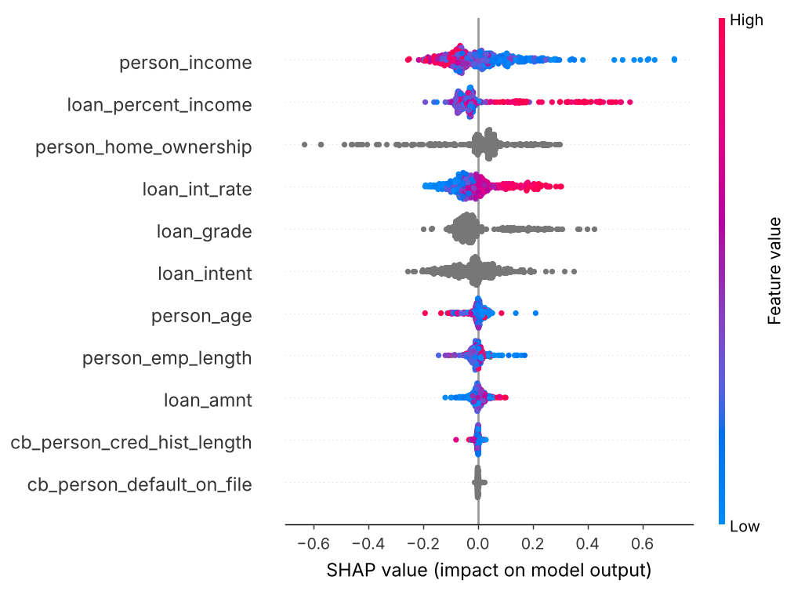

# Loan Credit Risk Predictor

Predicts whether a loan applicant will default, using a public credit risk dataset. It compares a logistic regression baseline with gradient boosting, picks a decision threshold on validation folds, explains predictions with SHAP, and serves them in a small Streamlit app.

## Problem

Given an applicant's income, age, employment length, loan details and credit history, estimate the probability that the loan ends in default (`loan_status = 1`), then approve or reject at a cutoff chosen so that at least 80% of defaulters are caught.

## Data

- Source: OpenML dataset 43454, "Credit-Risk-Dataset": https://www.openml.org/d/43454
- 32,581 rows, 11 features plus the target. 21.8% of raw rows are defaults.
- Licence: OpenML lists it as CC0 (public domain). Check the OpenML page before reusing it.
- The data is not stored in this repo. `python download_data.py` fetches it into `data/credit_risk.csv`.

Cleaning (see `credit_risk.clean`): 165 exact duplicate rows dropped, and 7 rows with an age over 100 or employment length over 60 years dropped. That leaves 32,409 rows. Missing values (895 in `person_emp_length`, 3,116 in `loan_int_rate`) are imputed inside the pipeline. `python eda.py` writes `reports/eda.json` and `reports/eda.png`.

## Method

- Split: stratified 80/20. 25,927 training rows and 6,482 test rows. The test set is used once, at the end.
- Preprocessing (sklearn Pipeline): median imputation with missing indicators and scaling for numbers, most-frequent imputation and one-hot encoding for categories (unseen categories ignored).
- Imbalance: `class_weight="balanced"` in both models. No resampling.
- Models: LogisticRegression and HistGradientBoostingClassifier (no LightGBM, no PyTorch).
- Validation: stratified 5-fold CV on the training split, seed 42. The model with the higher mean CV ROC-AUC is selected (HistGradientBoosting).
- Threshold rule: the highest cutoff whose recall is at least 0.80 on the 5-fold out-of-fold training predictions. Reject when probability is at or above the cutoff. That cutoff is then applied unchanged to the test set.
- Explanations: SHAP permutation explainer on the 11 raw features, probability scale (500 test rows, 100-row background). HistGradientBoosting is not supported by SHAP's tree explainer, so the model-agnostic explainer is used.

## Results

All numbers below are copied from `reports/metrics.json`, produced by `python train.py`.

| Metric | Logistic regression | HistGradientBoosting |
|---|---|---|
| CV ROC-AUC (mean +/- sd) | 0.8712 +/- 0.0050 | 0.9456 +/- 0.0025 |
| CV PR-AUC (mean +/- sd) | 0.7205 +/- 0.0118 | 0.9015 +/- 0.0028 |
| Threshold (from CV predictions) | 0.4483 | 0.4677 |
| CV precision / recall at threshold | 0.5120 / 0.8000 | 0.8222 / 0.8000 |
| Test ROC-AUC | 0.8719 | 0.9512 |
| Test PR-AUC | 0.7068 | 0.9112 |
| Test precision at threshold | 0.5066 | 0.8210 |
| Test recall at threshold | 0.8082 | 0.8216 |
| Test reject rate | 0.3490 | 0.2189 |

Selected model confusion matrix on the test set at its threshold: 4810 true negatives, 254 false positives, 253 false negatives, 1165 true positives.

Top features by mean absolute SHAP value (change in default probability):

1. `person_income` (0.0979)
2. `loan_percent_income` (0.0783)
3. `person_home_ownership` (0.0751)
4. `loan_int_rate` (0.0682)
5. `loan_grade` (0.0656)
6. `loan_intent` (0.0600)



Categorical features appear grey in the summary plot because they are plain labels, not ordered numbers.

## How to run

```
pip install -r requirements.txt
python download_data.py
python eda.py
python train.py
pytest
streamlit run app.py
```

`train.py` writes `models/` and `reports/`. The app needs `models/` to exist, so run `train.py` first. Training plus SHAP takes a few minutes on 2 CPUs.

## Tests

`pytest` covers the data schema and cleaning, pipeline fit and predict shapes, probability range, threshold logic, and the app helper functions. Last run: 21 passed.

## Limitations

- The dataset is a public sample with no dates, so there is no time-based split. Real lending needs out-of-time validation.
- Loan grade and interest rate are set by the lender before the outcome is known, which is fine for this exercise, but they already carry much of the risk signal.
- Test metrics come from one split and one seed. Differences of a point or two should not be over-read.
- The threshold targets recall of 0.80 on training folds. Test recall landed at 0.8216, so it does not hit 0.80 exactly on new data.
- No fairness analysis was done. Age and home ownership are inputs, and a real system would need that review and legal sign-off.
- SHAP reasons describe what the model uses, not causes.
- Not suitable for real credit decisions.
